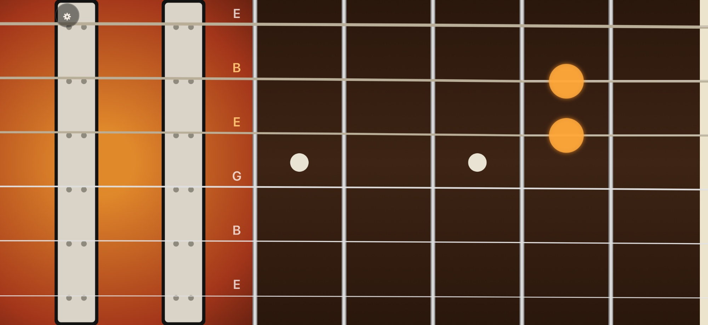

# Guitarophone



Turns your phone into an electric guitar, for iOS and Android.

Hold the phone sideways in front of your chest, like a guitar, with the screen facing outwards like the top of a guitar:

- **Left side (body):** strum across the strings with a finger of your right hand. Every string your finger crosses sounds. Tapping right on a string plucks only that string. Faster strums are louder.
- **Right side (neck):** hold the strings at the frets with your left hand. The neck shows frets 1 to 5 by default, and fret 1 is next to the nut on the far right.

Like on a real guitar:

- Open strings are in standard tuning: E A D G B E, with low E at the top.
- A string sounds at the highest fret any finger holds it at.
- Moving a finger along a ringing string changes its pitch (slides, hammer-ons, pull-offs).
- Lifting the last finger from a ringing string damps it.

In the settings (gear button) you can choose the amp tone (Clean, Crunch, Lead), swap the sides (strum on the right), and show or hide the note names.

With **Adjust** in the settings, you change the sizes right on the guitar by dragging handles:

- the upper edge of the neck: adds an empty border above the low E string, which makes the neck narrower,
- the line between strum area and neck,
- and the number of frets (1 to 12).

## How it works

The app is a web app (TypeScript, no framework) packaged as a native app with [Capacitor](https://capacitorjs.com).

| File | What it does |
| --- | --- |
| `src/guitar.ts` | Tuning, note names and frequencies |
| `src/layout.ts` | Where the strum zone, frets and strings are on screen, and their adjustable sizes |
| `src/input.ts` | Turns finger movements into plucks and held frets |
| `src/audio/string-voice.ts` | One string, simulated with the Karplus-Strong method |
| `src/audio/guitar-processor.ts` | Audio worklet that mixes the six strings |
| `src/audio/engine.ts` | Amplifier: distortion, speaker cabinet filter, reverb |
| `src/audio/tones.ts` | Settings of the amp tones (Clean, Crunch, Lead) |
| `src/render.ts` | Draws the guitar on a canvas |
| `src/adjust.ts` | Mode for adjusting the sizes with handles on the guitar |
| `src/main.ts` | Connects everything, settings and start screen |

Native changes:

- iOS (`ios/App/App`): landscape only, sound plays also with the silent switch on, and swipes from the screen edges go to the guitar first, so strumming near an edge does not open Control Center.
- Android (`android/app/src/main`): landscape only and full screen.

## Development

Requirements: Node.js, Xcode (iOS), Android Studio (Android).

```sh
npm install
npm test          # unit tests, including pitch checks of the string sound
npm run dev       # web version in the browser; open it on a phone in the same network
npm run ios       # build, copy to the iOS project and open Xcode
npm run android   # build, copy to the Android project and open Android Studio
```

After changing the web code, run `npm run sync` to copy it into both native projects.
